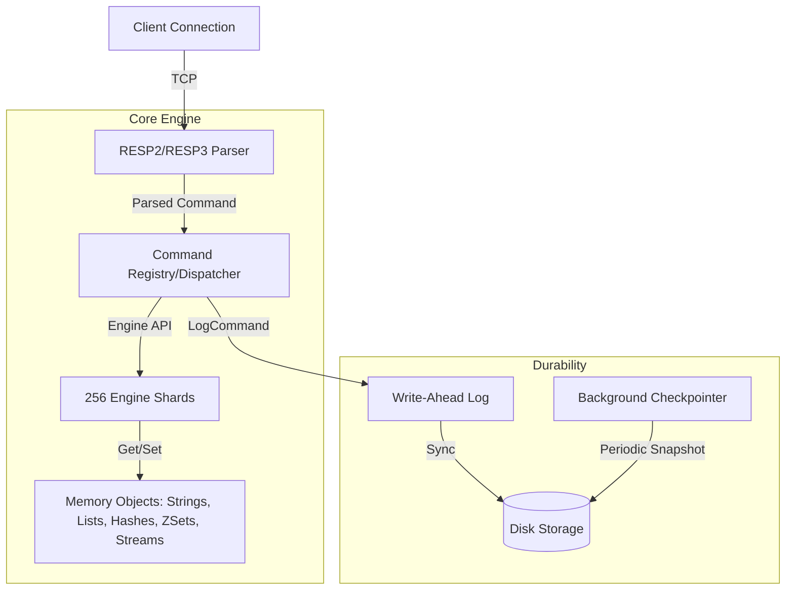

# FrostDB (not production ready yet)

FrostDB is a Windows-first, drop-in replacement for Redis — built from scratch in Go with zero POSIX dependencies.

It started with queue, worker, and delayed-job workloads as the first target, and now covers the full Redis command surface needed for production use: strings, lists, hashes, sets, sorted sets, streams, transactions, pub/sub, and RDB compatibility.

## Why This Exists

Redis is excellent software, but its implementation model is strongly shaped by Unix and POSIX behavior. That becomes a problem on Windows for two reasons:

1. `fork()` is a Unix primitive and does not exist on Windows.
2. Several Redis workflows rely on child-process semantics for background persistence and rewrite paths.

FrostDB takes the opposite approach:

- No `fork()` dependency
- No child-process based persistence model
- No global lock around the entire database
- Sharded in-memory execution from day one (256 shards)
- RESP2 / RESP3 protocol support (fully compatible with `redis-py`)
- Forkless WAL-based persistence
- RDB import/export for seamless migration from Redis
- Drop-in backend replacement for most worker framework

## Features

### Commands

| Category | Commands |
|----------|----------|
| Strings | GET, SET, INCR, DECR, INCRBY, DECRBY, INCRBYFLOAT, APPEND, STRLEN, MGET, MSET, MSETNX, SETNX, SETEX, PSETEX, GETSET, GETEX, GETDEL |
| Keys | DEL, UNLINK, EXPIRE, PEXPIRE, EXPIREAT, PEXPIREAT, PERSIST, TTL, PTTL, SCAN, KEYS, PING, ECHO, INFO, EXISTS, TYPE, RENAME, RENAMENX, RANDOMKEY, DBSIZE, FLUSHDB, FLUSHALL, SELECT |
| Lists | LPUSH, RPUSH, LPOP, RPOP, BLPOP, BRPOP, LRANGE, LMOVE, LREM, LLEN, LINDEX, LSET, LINSERT |
| Hashes | HSET, HSETNX, HGET, HDEL, HGETALL, HLEN, HINCRBY, HINCRBYFLOAT, HEXISTS, HKEYS, HVALS, HMGET |
| Sets | SADD, SREM, SMEMBERS, SISMEMBER, SCARD, SPOP, SRANDMEMBER, SINTER, SINTERSTORE, SUNION, SUNIONSTORE, SDIFF, SDIFFSTORE |
| Sorted Sets | ZADD, ZREM, ZRANGE, ZRANGEBYSCORE, ZREMRANGEBYSCORE, ZPOPMIN |
| Streams | XADD, XREVRANGE, XREADGROUP, XACK, XPENDING, XAUTOCLAIM, XGROUP |
| Transactions | MULTI, EXEC, DISCARD, WATCH, UNWATCH |
| PubSub | SUBSCRIBE, UNSUBSCRIBE, PUBLISH |
| Server | HELLO, CLIENT, CONFIG, SAVE, BGSAVE, OBJECT, MEMORY, CLUSTER, DBSIZE |

### Persistence

Forkless write-ahead log with checkpoint support:

```
write → WAL append → memory apply
recovery: checkpoint + WAL replay
```

- CRC32 checksummed WAL entries
- Automatic WAL file rotation at 64MB
- Periodic full checkpoints (configurable interval)
- Recovery loads latest checkpoint then replays WAL on top

### RDB Import / Export

Full Redis RDB file compatibility for migration:

```bash
# Auto-loads ./data/dump.rdb on startup (standard Redis behavior)
./frost.exe

# Or specify a custom RDB file to import on startup
./frost.exe --import-rdb /path/to/dump.rdb

# Export live state while server is running
redis-cli SAVE
redis-cli BGSAVE

# Export from persisted state without starting the server
./frost.exe --export-rdb /path/to/backup.rdb
```

- Automatically loads `dump.rdb` from data directory on boot (like Redis)
- Supports all data types: Strings, Lists, Sets, Hashes, Sorted Sets, Streams
- Preserves TTLs, consumer groups, and pending entries
- Uses [hdt3213/rdb](https://github.com/HDT3213/rdb) (RDB v1–v12, up to Redis 7.2)
- `SAVE` blocks until complete; `BGSAVE` runs in background
- `--export-rdb` reads from disk (WAL + checkpoint), does not start the server

### Architecture



Commands are plugins. They receive a context (which tracks transaction state and `HELLO` protocol version), call the engine API, and return RESP values. No command touches the network or storage layer directly.

## Build

Requires [Go 1.22+](https://go.dev/doc/install).

```bash
go build -o frost.exe ./cmd/frost
```

## Run

```bash
./frost.exe
```

Listens on port `6379` by default. Data is persisted to `./data/` (override with `FROST_DATA_DIR` env var).

### Logging

Structured leveled logging (built on Go's `log/slog`):

```bash
# Set log level (debug, info, warn, error)
./frost.exe --loglevel debug

# JSON output (for log aggregators like Loki, Datadog, etc.)
./frost.exe --log-json
```

### Graceful Shutdown

FrostDB handles `SIGINT` / `SIGTERM` (or Ctrl+C) gracefully:

1. Stops accepting new connections
2. Drains in-flight client requests
3. Flushes and closes the WAL
4. Exits cleanly

No data loss on controlled shutdown.

### Memory Eviction

```bash
# Start with 256MB memory limit and LRU eviction
./frost.exe --maxmemory 268435456 --maxmemory-policy allkeys-lru
```

Configure at runtime via `CONFIG SET`:

```bash
redis-cli CONFIG SET maxmemory 100mb
redis-cli CONFIG SET maxmemory-policy allkeys-lfu
redis-cli CONFIG GET maxmemory*
```

Supported policies: `noeviction`, `allkeys-lru`, `allkeys-lfu`, `allkeys-random`, `volatile-lru`, `volatile-lfu`, `volatile-random`, `volatile-ttl`.

### Keyspace Notifications

Redis-compatible keyspace notifications via PubSub:

```bash
# Enable all keyspace notifications
redis-cli CONFIG SET notify-keyspace-events KEA

# Subscribe to expired key events
redis-cli SUBSCRIBE __keyevent@0__:expired

# Subscribe to all events on a specific key
redis-cli SUBSCRIBE __keyspace@0__:mykey
```

Flags: `K` (keyspace), `E` (keyevent), `g` (generic), `$` (string), `l` (list), `s` (set), `h` (hash), `z` (zset), `x` (expired), `e` (evicted), `t` (stream), `A` (all).

## Test

```bash
go test ./...
```

### Test Coverage

14 test packages, 35+ test cases covering:

| Package | Tests |
|---------|-------|
| command/generic | PING, ECHO, DEL, EXPIRE, INFO, SCAN, CLIENT |
| command/string | GET, SET, wrong type handling |
| command/listcmd | Push/Pop, blocking BLPOP |
| command/zsetcmd | ZADD, ZRANGE, ZPOPMIN, ZRANGEBYSCORE, flags |
| command/streamcmd | XADD, XREADGROUP, XACK, XPENDING full flow |
| command/tx | MULTI/EXEC, DISCARD, nested MULTI, error abort |
| command/pubsub | PUBLISH with 0/1/N subscribers, UNSUBSCRIBE |
| engine/core | Get/Set, Del, Expire, persistence round-trip, checkpoint+recover |
| engine/object | List, Stream (add/read/ack/autoclaim), ZSet |
| persistence/wal | Append/Read, rotation, checksum integrity |
| persistence/checkpoint | Write/Read, latest discovery, invalid magic |
| persistence/recovery | Empty, checkpoint-only, WAL-only, combined |
| resp/parser | SimpleString, Array, inline commands |

## Benchmarks

Run benchmarks with:

```bash
go test -bench . -benchmem ./bench
```

Results on Intel Core i5 @ 2.50GHz, Windows, 4 cores (after zero-allocation pipeline overhaul):

| Benchmark | ops/sec | ns/op | allocs/op |
|-----------|---------|-------|-----------|
| TCP Server (SET) | ~97,686 | 12,409 | - |
| SET | 2,589,223 | 486 | 5 |
| GET | 8,543,374 | 150 | 1 |
| SET (parallel) | 3,203,698 | 378 | 11 |
| List queue (RPUSH+LPOP) | 1,000,000 | 1,154 | 14 |
| List queue (parallel) | 1,505,142 | 723 | 16 |
| Delayed queue (ZADD+ZPOPMIN) | 409,173 | 2,688 | 27 |
| XADD | 1,000,000 | 1,046 | 14 |
| Stream consumer (XADD+XREADGROUP+XACK) | ~281,041 | 4,085 | 50 |

### Performance Architecture
- **Zero-Alloc Hot Paths**: Pre-allocated RESP types, `unsafe.String` casting, and inline FNV-1a hashing eliminate garbage collection pauses on hot keys.
- **Data Structure Pooling**: `sync.Pool` extensively used for `ListNode`, `SkiplistNode`, and `WAL` byte buffers.
- **Radix-like BTree Streams**: Streams are internally backed by `btree.BTreeG` blocks of packed arrays (Listpacks) combined with zero-alloc `StreamID` structs. This reduces pointers by a factor of 100x and avoids massive GC pauses when scanning millions of stream entries.
- **O(1) Stream Consumers**: Consumers track precise byte offsets and `StreamID` structs rather than performing O(N) string-parsing scans.
- **Forkless Persistence**: Zero-overhead dense binary WAL serialization.

## Ecosystem Compatibility
- **redis-py**: Fully supports connecting, handshaking (`HELLO 3`), and communicating with Python's official Redis client.
- **rq (Redis Queue)**: Fully implements all complex internal List, Set, Hash, and Sorted Set commands (like `LMOVE`, `ZREMRANGEBYSCORE`, `HINCRBY`) needed to run Python `rq` jobs out of the box (requires using `SimpleWorker` on Windows due to OS fork limitations).

## Usage

Connect with any Redis client:

```bash
redis-cli PING
redis-cli SET mykey "Hello World"
redis-cli GET mykey
```

Blocking queue:

```bash
# Terminal 1
redis-cli BLPOP myqueue 0

# Terminal 2
redis-cli LPUSH myqueue "Task 1"
```

Stream consumer group:

```bash
redis-cli XGROUP CREATE mystream workers 0 MKSTREAM
redis-cli XADD mystream '*' task "process-order" id "123"
redis-cli XREADGROUP GROUP workers w1 COUNT 1 STREAMS mystream '>'
redis-cli XACK mystream workers 1234567890-0
```

Transactions:

```bash
redis-cli MULTI
redis-cli SET counter 1
redis-cli SET status active
redis-cli EXEC
```

## Design Principles

- Commands are plugins
- Engine is isolated behind an interface
- Streams are first class
- Persistence is forkless
- Everything sharded from day 1
- Files stay under 300 lines
- WAL write failures propagate to the client (`ERR persistence failure`) — no silent data loss
- Panic recovery per connection — one bad request never crashes the server
- Structured logging with levels — no noisy output in production, full detail in debug


## Redis test cases passing:

./runtest --host 127.0.0.1 --port 6379 --verbose --single unit/type/list-3

./runtest --host 127.0.0.1 --port 6379 --verbose --single unit/type/list-2

./runtest --host 127.0.0.1 --port 6379 --verbose --single unit/type/list

./runtest --host 127.0.0.1 --port 6379 --verbose --single unit/type/stream

./runtest --host 127.0.0.1 --port 6379 --verbose --single unit/type/string

./runtest --host 127.0.0.1 --port 6379 --verbose --single unit/sort

./runtest --host 127.0.0.1 --port 6379 --verbose --single unit/pubsub

./runtest --host 127.0.0.1 --port 6379 --verbose --single unit/scan

./runtest --host 127.0.0.1 --port 6379 --verbose --single unit/limits

./runtest --host 127.0.0.1 --port 6379 --verbose --single unit/wait

./runtest --host 127.0.0.1 --port 6379 --verbose --single unit/bitfield

./runtest --host 127.0.0.1 --port 6379 --verbose --single unit/bitops

./runtest --host 127.0.0.1 --port 6379 --verbose --single unit/type/incr

./runtest --host 127.0.0.1 --port 6379 --verbose --single unit/type/array

./runtest --host 127.0.0.1 --port 6379 --verbose --single unit/type/hash

./runtest --host 127.0.0.1 --port 6379 --verbose --single unit/type/set

./runtest --host 127.0.0.1 --port 6379 --verbose --single unit/type/zset

## Benchmarks

| Metric              | **FrostDB** | **Redis 8** |   **Valkey** | **DragonflyDB** |
| ------------------- | ----------: | ----------: | -----------: | --------------: |
| **SET ops/s**       |  **79,039** | **107,821** |  **109,077** |     **107,613** |
| **GET ops/s**       |  **86,522** | **105,472** |  **111,500** |     **104,824** |
| **SET avg latency** |    2.314 ms |    1.699 ms |     1.683 ms |    **1.321 ms** |
| **GET avg latency** |    2.039 ms |    1.690 ms |     1.638 ms |    **1.354 ms** |
| **SET P50**         |    1.791 ms |    1.591 ms |     1.591 ms |    **1.063 ms** |
| **GET P50**         |    1.527 ms |    1.559 ms |     1.559 ms |    **1.143 ms** |
| **SET P95**         |    6.359 ms |    2.695 ms | **2.543 ms** |        3.487 ms |
| **GET P95**         |    5.807 ms |    2.863 ms | **2.495 ms** |        3.455 ms |
| **SET P99**         |   10.175 ms |    4.127 ms | **3.799 ms** |        5.631 ms |
| **GET P99**         |    9.223 ms |    5.431 ms | **3.799 ms** |        5.487 ms |
| **Max latency**     |     51.1 ms |     42.9 ms |      43.9 ms |     **24.7 ms** |
